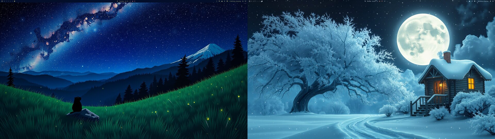

# Living Themes Background

A live wallpaper for Omarchy, part of [Omarchy Living Themes](https://github.com/prostratepossum/omarchy-living-themes). It animates the wallpapers of the [Alpine Marmot](https://github.com/prostratepossum/omarchy-alpine-marmot-theme) and [Moonlit Hearth](https://github.com/prostratepossum/omarchy-moonlit-hearth-theme) themes: on Starwatch wallpapers the stars twinkle, fireflies drift through the grass and a shooting star crosses now and then; on Moonlit Hearth wallpapers snow falls, the moon halo breathes, the cabin windows flicker and the chimney smokes.

The scene is picked from the wallpaper filename (`starwatch` or `moonlithearth`). Any other wallpaper stays static, exactly like the stock background. It is a fork of Omarchy's built-in `omarchy.background`, runs at 30 fps and pauses while a window is fullscreen. On an RX 9070 XT it costs about 7% GPU busy.



## Install

```bash
omarchy plugin add https://github.com/prostratepossum/omarchy-living-background --enable
```

Enabling it switches off the built-in `omarchy.background` automatically.

For the full set (wallpaper, lock screen, intro, click effects, login screen and automatic theme switching), use the [Living Themes installer](https://github.com/prostratepossum/omarchy-living-themes) instead.

## Use

```bash
omarchy-shell -q background toggleAnimation   # pause / resume
omarchy-shell -q background setAnimation false
```

## Remove

```bash
omarchy plugin remove io.github.prostratepossum.living-background
```

This restores the stock background plugin.

## Dependencies

None beyond Omarchy (Quickshell / Qt 6). Shaders ship precompiled (`.qsb`).

## License

Code: MIT. Scene artwork (wallpaper plates, badges): free for personal use; please don't resell it or use it in other products without asking. This repository is split out of [omarchy-living-themes](https://github.com/prostratepossum/omarchy-living-themes); send issues and changes there.
