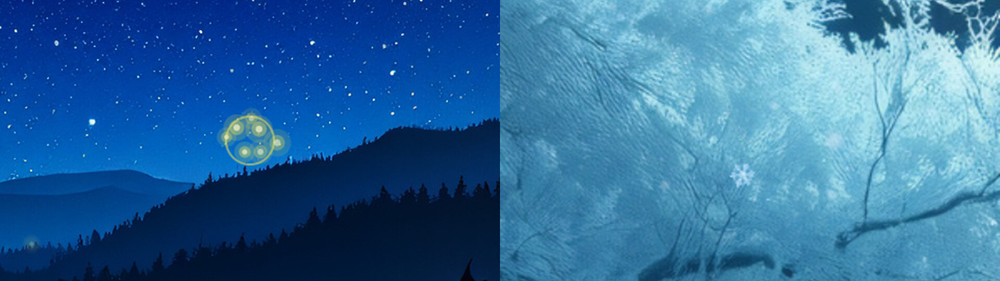

# Living Themes Click Effects

Small effects wherever you click, matched to the theme. Part of [Omarchy Living Themes](https://github.com/prostratepossum/omarchy-living-themes). Alpine Marmot gets fireflies on left click, sparkles on right and a ripple on middle. Moonlit Hearth gets a snowflake drifting down on left and right click and a faint frost ring on middle. Other themes get none. The overlay is click-through and skipped over fullscreen windows.



## Install

```bash
omarchy plugin add https://github.com/prostratepossum/omarchy-living-clicks --enable
```

For the full set (wallpaper, lock screen, intro, click effects, login screen and automatic theme switching), use the [Living Themes installer](https://github.com/prostratepossum/omarchy-living-themes) instead.

## Use

```bash
omarchy-shell -q clicks test            # play one at the screen centre
omarchy-shell -q clicks toggle          # on / off
```

## Remove

```bash
omarchy plugin remove io.github.prostratepossum.living-clicks
```

## Dependencies

The helper reads mouse buttons through evdev, so it needs:

```bash
sudo pacman -S python-evdev
sudo usermod -aG input $USER   # then log out and back in
```

It only opens mouse-type devices and only reads button presses, never keyboards or movement. The `input` group lets any program you run read input devices, so skip this plugin if that trade-off isn't for you.

## License

Code: MIT. Scene artwork (wallpaper plates, badges): free for personal use; please don't resell it or use it in other products without asking. This repository is split out of [omarchy-living-themes](https://github.com/prostratepossum/omarchy-living-themes); send issues and changes there.
