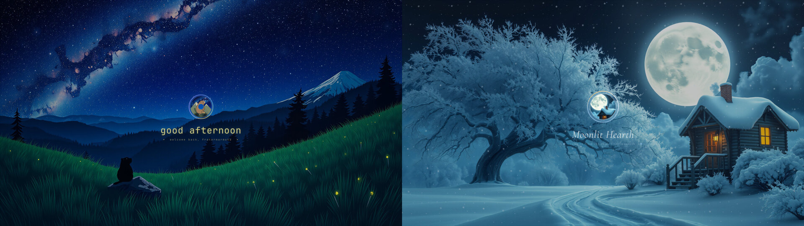

# Living Themes Intro

A short login intro for Omarchy, part of [Omarchy Living Themes](https://github.com/prostratepossum/omarchy-living-themes). It plays once per boot, about 5 seconds, over Starwatch or Moonlit Hearth wallpapers: the scene fades in, fireflies or snow gather into the theme badge, a greeting appears, and an iris opens onto your desktop. It is click-through, so it never blocks you. Other wallpapers get no intro.



## Install

```bash
omarchy plugin add https://github.com/prostratepossum/omarchy-living-intro --enable
```

For the full set (wallpaper, lock screen, intro, click effects, login screen and automatic theme switching), use the [Living Themes installer](https://github.com/prostratepossum/omarchy-living-themes) instead.

## Use

```bash
omarchy-shell -q intro play   # replay it
```

## Remove

```bash
omarchy plugin remove io.github.prostratepossum.living-intro
```

## Dependencies

None beyond Omarchy (Quickshell / Qt 6).

## License

Code: MIT. Scene artwork (wallpaper plates, badges): free for personal use; please don't resell it or use it in other products without asking. This repository is split out of [omarchy-living-themes](https://github.com/prostratepossum/omarchy-living-themes); send issues and changes there.
