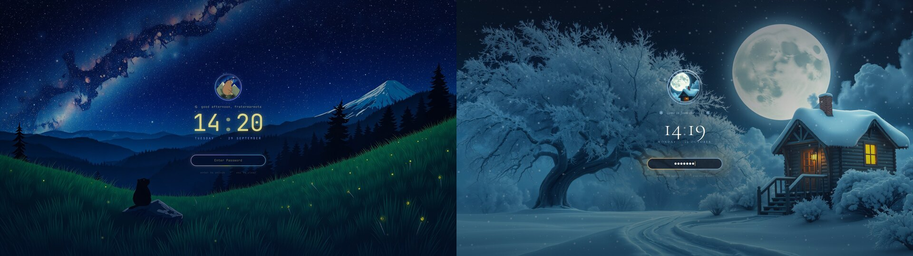

# Living Themes Lock Screen

An animated lock screen for Omarchy, part of [Omarchy Living Themes](https://github.com/prostratepossum/omarchy-living-themes). With a Starwatch wallpaper you get the live sky, the marmot badge in an aurora ring, fireflies and sparks on each keystroke. With a Moonlit Hearth wallpaper you get the snowy scene, the moon-and-cabin badge, falling snow, a warm firelight glow on the password field and snowflakes on each keystroke. Other wallpapers get a plain version in your theme's colors.

It is a fork of Omarchy's built-in `omarchy.lock`; authentication is unchanged.



## Install

```bash
omarchy plugin add https://github.com/prostratepossum/omarchy-living-lock --enable
```

Enabling it switches off the built-in `omarchy.lock` automatically.

For the full set (wallpaper, lock screen, intro, click effects, login screen and automatic theme switching), use the [Living Themes installer](https://github.com/prostratepossum/omarchy-living-themes) instead.

## Use

```bash
omarchy-shell lock previewInteractive   # try it without locking (closes after 90 s)
omarchy-shell lock hidePreview
```

## Remove

```bash
omarchy plugin remove io.github.prostratepossum.living-lock
```

This restores the stock lock screen.

## Dependencies

None beyond Omarchy (Quickshell / Qt 6). Cormorant Garamond is bundled for the Hearth scene (SIL OFL 1.1, license included).

## License

Code: MIT. Scene artwork (wallpaper plates, badges): free for personal use; please don't resell it or use it in other products without asking. This repository is split out of [omarchy-living-themes](https://github.com/prostratepossum/omarchy-living-themes); send issues and changes there.
